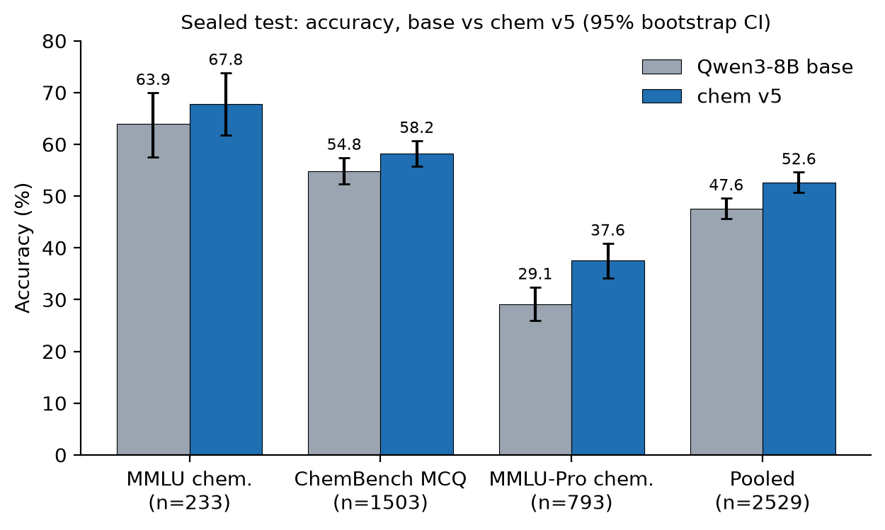

# qwen3-8b-chem-v5 — QLoRA chemistry adapter for Qwen3-8B

**Author:** Giovanni Del Papa, Independent researcher, Italy, giovanni.delpapa@live.it
**License:** Apache-2.0 (same as the base model [Qwen/Qwen3-8B](https://huggingface.co/Qwen/Qwen3-8B))

A QLoRA adapter (rank 16, α = 32, dropout 0.05, all attention and MLP projections: q, k, v, o, gate, up, down; about 43.6 M trainable parameters) for **Qwen3-8B** (8B, not 14B). It was trained for one epoch on 11,839 permissively licensed chemistry examples (4.70 M tokens) on a single 12 GB laptop GPU (MSI, NVIDIA RTX 4080). Some training examples are Wikipedia-derived (CC BY-SA 4.0); see *Limitations*.

Paper (DOI): [10.5281/zenodo.24326181](https://doi.org/10.5281/zenodo.24326181).



## English

### Method

QLoRA in 4-bit NF4, 1 epoch, 370 steps, cosine schedule, learning rate 3e-5, warmup 0.05, max sequence length 2048, micro-batch 32, seed 3407, ~2.15 hours on one 12 GB GPU.

Evaluation (base vs adapter): 4-bit NF4 inference, zero-shot, non-thinking, letter-probability scoring, paired bootstrap 95% confidence intervals with 10,000 resamples. The development split and the sealed test are reported side by side.

### Results

**Sealed test** (n = 2,529, run once on 17 November 2026). Pooled 47.61% → 52.63% (+5.02 points, 95% CI +3.24 to +6.76). 328 items gained, 201 lost. Pre-specified gate: **PASS**. During this run, netmon recorded 0 network connections. `mmlupro_chem` was re-run alone after a segfault in run 1.

**Development split** (n = 1,083), same protocol. Pooled +1.20 points (95% CI −1.29 to +3.79). ChemBench −1.40. Gate: **FAIL**.

| Split | Benchmark | n | Base | Adapter | Difference [95% CI] |
|---|---|---:|---:|---:|---|
| Sealed test | Pooled | 2529 | 47.61% | 52.63% | **+5.02 [+3.24, +6.76]** PASS |
| Sealed test | MMLU chemistry | 233 | 63.95% | 67.81% | +3.86 [−0.43, +8.15] |
| Sealed test | ChemBench MCQ | 1503 | 54.82% | 58.22% | +3.39 [+1.13, +5.72] |
| Sealed test | MMLU-Pro chemistry | 793 | 29.13% | 37.58% | +8.45 [+5.17, +11.73] |
| Development | Pooled | 1083 | 50.69% | 51.89% | +1.20 [−1.29, +3.79] FAIL |
| Development | MMLU chemistry | 100 | 64.00% | 63.00% | −1.00 [−6.00, +4.00] |
| Development | ChemBench MCQ | 644 | 60.09% | 58.70% | −1.40 [−4.97, +2.02] |
| Development | MMLU-Pro chemistry | 339 | 28.91% | 35.69% | +6.78 [+2.36, +11.21] |

### How to load and run the model

#### (a) With Ollama (recommended if you just want to chat)

The Ollama image is a GGUF Q4_K_M of the **merged** adapter (base + LoRA already fused). Nothing else needs downloading: no separate Qwen3-8B and no PEFT.

```
ollama pull ollamagdp/qwen3-8b-chem-v5
ollama run ollamagdp/qwen3-8b-chem-v5
```

You need a recent Ollama and about 5 GB of disk. At least 8 GB of RAM or VRAM is recommended; with less it still runs, more slowly, partly on CPU. This GGUF is an approximation of the evaluated object (the evaluation was 4-bit NF4 LoRA on the base, not this quantized merge). The model can reason visibly ("thinking"); through the API use `"think": false` to match the evaluation setting.

Page: [ollama.com/ollamagdp/qwen3-8b-chem-v5](https://ollama.com/ollamagdp/qwen3-8b-chem-v5)

#### (b) With the raw adapter (PEFT / Transformers)

Download the base **Qwen/Qwen3-8B** first (it is an 8B model, **not** 14B). Then load this adapter with PEFT. Tokenizer files are not shipped here; use the base tokenizer.

```python
import torch
from transformers import AutoModelForCausalLM, AutoTokenizer, BitsAndBytesConfig
from peft import PeftModel

BASE = "Qwen/Qwen3-8B"
ADAPTER = "odelpa/qwen3-8b-chem-v5"

# Same 4-bit NF4 setup as the evaluation. For bf16, drop quantization_config
# and pass torch_dtype=torch.bfloat16 instead.
bnb = BitsAndBytesConfig(
    load_in_4bit=True,
    bnb_4bit_quant_type="nf4",
    bnb_4bit_compute_dtype=torch.bfloat16,
)

tok = AutoTokenizer.from_pretrained(BASE)
model = AutoModelForCausalLM.from_pretrained(
    BASE,
    quantization_config=bnb,
    device_map="auto",
)
model = PeftModel.from_pretrained(model, ADAPTER, subfolder="adapter")
# Optional: fuse the adapter into the base weights (needs more memory)
# model = model.merge_and_unload()

messages = [{"role": "user", "content": "What is the oxidation state of Fe in Fe2O3?"}]
inputs = tok.apply_chat_template(
    messages,
    add_generation_prompt=True,
    enable_thinking=False,  # non-thinking, as in the evaluation
    return_tensors="pt",
).to(model.device)

out = model.generate(inputs, max_new_tokens=128, do_sample=False)
print(tok.decode(out[0][inputs.shape[1]:], skip_special_tokens=True))
```

A copy of this snippet is in `examples/load_adapter.py`.

### Network transparency

This adapter has no tools of its own and does not open network connections. During the sealed test, a network monitor (netmon) recorded **0 connections**. Any download of the base model or of this repository is done by your own code or by Ollama, not by the model.

### Limitations

1. **Dev/test gap.** The development gate failed (pooled +1.20, CI crossing zero; ChemBench −1.40). The sealed test passed (+5.02). Both results are reported. The gain on the sealed test should be read with this discrepancy in mind.
2. **Crash and re-run.** In sealed-test run 1, `mmlupro_chem` segfaulted and was re-run alone. The other two benchmarks were not re-run.
3. **4-bit evaluation.** All reported numbers were measured in 4-bit NF4, zero-shot, non-thinking, with letter-probability scoring, not with open-ended generation and not on the Ollama GGUF.
4. **Training data / CC BY-SA.** Some examples are derived from Wikipedia (CC BY-SA 4.0). Share-alike obligations may apply to those materials; whether they extend to trained weights is an open legal question. The adapter itself is released under Apache-2.0, with this notice.
5. One run, one seed, laptop-scale compute. No safety evaluation. No chemical, medical, legal or other professional guarantee. Check any factual claim.

### Files

- `adapter/adapter_model.safetensors` and `adapter/adapter_config.json` (LoRA only; no base weights)
- `figures/` (accuracy, forest plot, gains/losses)
- `examples/load_adapter.py`
- `gguf/` (Q4_K_M merge for Ollama, when present; not the evaluated object)
- `LICENSE` (Apache-2.0), `NOTICE`

### Links

- Hugging Face (this repo): [odelpa/qwen3-8b-chem-v5](https://huggingface.co/odelpa/qwen3-8b-chem-v5)
- GitHub (card, figures, loading example; no weights): [usergdp136/qwen3-8b-chem-v5](https://github.com/usergdp136/qwen3-8b-chem-v5)
- Ollama: [ollamagdp/qwen3-8b-chem-v5](https://ollama.com/ollamagdp/qwen3-8b-chem-v5)
- Paper (DOI): [10.5281/zenodo.24326181](https://doi.org/10.5281/zenodo.24326181)

---

## Italiano

Adattatore QLoRA (rango 16, α = 32, dropout 0,05, proiezioni di attenzione e MLP; circa 43,6 M parametri addestrabili) per **Qwen3-8B** (8B, non 14B). Addestrato per un'epoca su 11.839 esempi di chimica con licenze permissive (4,70 M token) su una sola GPU da portatile da 12 GB. Una parte degli esempi deriva da Wikipedia (CC BY-SA 4.0); vedi *Limiti*.

Articolo (DOI): [10.5281/zenodo.24326181](https://doi.org/10.5281/zenodo.24326181).

### Metodo

QLoRA in 4 bit NF4, 1 epoca, 370 passi, schedulazione cosine, learning rate 3e-5, seed 3407, circa 2,15 ore.

Valutazione (base contro adattatore): inferenza 4 bit NF4, zero-shot, non-thinking, punteggio sulle probabilità delle lettere, intervalli di confidenza 95% con bootstrap appaiato da 10.000 campioni. Lo split di sviluppo e il test sigillato sono riportati affiancati.

### Risultati

**Test sigillato** (n = 2.529, eseguito una sola volta il 17 novembre 2026). Complessivo 47,61% → 52,63% (+5,02 punti, IC 95% da +3,24 a +6,76). 328 domande guadagnate, 201 perse. Gate predefinito: **superato**. Durante la prova, netmon ha registrato 0 connessioni di rete. `mmlupro_chem` è stato rilanciato da solo dopo un segfault nella run 1.

**Split di sviluppo** (n = 1.083), stesso protocollo. Complessivo +1,20 punti (IC 95% da −1,29 a +3,79). ChemBench −1,40. Gate: **non superato**.

La tabella nella sezione inglese riporta gli stessi numeri.

### Come caricare e far partire il modello

#### (a) Con Ollama (consigliato se vuoi solo usarlo)

L'immagine Ollama è un GGUF Q4_K_M dell'adattatore **già fuso** nel modello base. Non serve scaricare altro: né Qwen3-8B a parte, né PEFT.

```
ollama pull ollamagdp/qwen3-8b-chem-v5
ollama run ollamagdp/qwen3-8b-chem-v5
```

Serve un Ollama aggiornato e circa 5 GB di disco. Sono consigliati almeno 8 GB di RAM o VRAM; con meno memoria funziona, più lentamente, in parte su CPU. Questo GGUF è un'approssimazione dell'oggetto valutato (la valutazione è stata fatta in 4 bit NF4 sull'adattatore, non su questo merge quantizzato). Il modello può ragionare in modo visibile («thinking»): via API usare `"think": false` per allinearsi alla valutazione.

Pagina: [ollama.com/ollamagdp/qwen3-8b-chem-v5](https://ollama.com/ollamagdp/qwen3-8b-chem-v5)

#### (b) Con l'adattatore grezzo (PEFT / Transformers)

Scarica prima il modello base **Qwen/Qwen3-8B** (è un 8B, **non** un 14B). Poi carica questo adattatore con PEFT. I file del tokenizer non sono inclusi: usa quelli del base.

```python
import torch
from transformers import AutoModelForCausalLM, AutoTokenizer, BitsAndBytesConfig
from peft import PeftModel

BASE = "Qwen/Qwen3-8B"
ADAPTER = "odelpa/qwen3-8b-chem-v5"

bnb = BitsAndBytesConfig(
    load_in_4bit=True,
    bnb_4bit_quant_type="nf4",
    bnb_4bit_compute_dtype=torch.bfloat16,
)

tok = AutoTokenizer.from_pretrained(BASE)
model = AutoModelForCausalLM.from_pretrained(
    BASE, quantization_config=bnb, device_map="auto",
)
model = PeftModel.from_pretrained(model, ADAPTER, subfolder="adapter")
# Facoltativo: fondere l'adattatore nei pesi del base (serve più memoria)
# model = model.merge_and_unload()

messages = [{"role": "user", "content": "Qual è lo stato di ossidazione del Fe in Fe2O3?"}]
inputs = tok.apply_chat_template(
    messages,
    add_generation_prompt=True,
    enable_thinking=False,  # non-thinking, come nella valutazione
    return_tensors="pt",
).to(model.device)

out = model.generate(inputs, max_new_tokens=128, do_sample=False)
print(tok.decode(out[0][inputs.shape[1]:], skip_special_tokens=True))
```

Una copia è in `examples/load_adapter.py`.

### Trasparenza di rete

Questo adattatore non ha strumenti propri e non apre connessioni di rete. Durante il test sigillato, un monitor di rete (netmon) ha registrato **0 connessioni**. L'eventuale download del modello base o di questo archivio lo fa il tuo codice, o Ollama, non il modello.

### Limiti

1. **Scarto tra sviluppo e test.** Il gate di sviluppo non è stato superato (complessivo +1,20, intervallo che include lo zero; ChemBench −1,40). Il test sigillato è stato superato (+5,02). Entrambi i risultati sono riportati. Il guadagno sul test sigillato va letto tenendo conto di questa differenza.
2. **Crash e rilancio.** Nella run 1 del test sigillato, `mmlupro_chem` è andato in segfault ed è stato rilanciato da solo. Gli altri due benchmark non sono stati rifatti.
3. **Valutazione in 4 bit.** Tutti i numeri sono stati misurati in 4 bit NF4, zero-shot, non-thinking, con punteggio sulle probabilità delle lettere, non con generazione aperta e non sul GGUF di Ollama.
4. **Dati di addestramento / CC BY-SA.** Una parte degli esempi deriva da Wikipedia (CC BY-SA 4.0). Sui materiali di origine possono valere obblighi di share-alike; se questi si estendano ai pesi addestrati è una questione giuridica aperta. L'adattatore è pubblicato in Apache-2.0, con questo avviso.
5. Un solo run, un solo seed, calcolo su portatile. Nessuna valutazione di sicurezza. Nessuna garanzia chimica, medica, legale o professionale. Verificare ogni affermazione di fatto.

### Link

- Hugging Face: [odelpa/qwen3-8b-chem-v5](https://huggingface.co/odelpa/qwen3-8b-chem-v5)
- GitHub (scheda, figure, esempio di caricamento; senza pesi): [usergdp136/qwen3-8b-chem-v5](https://github.com/usergdp136/qwen3-8b-chem-v5)
- Ollama: [ollamagdp/qwen3-8b-chem-v5](https://ollama.com/ollamagdp/qwen3-8b-chem-v5)
- Articolo (DOI): [10.5281/zenodo.24326181](https://doi.org/10.5281/zenodo.24326181)
